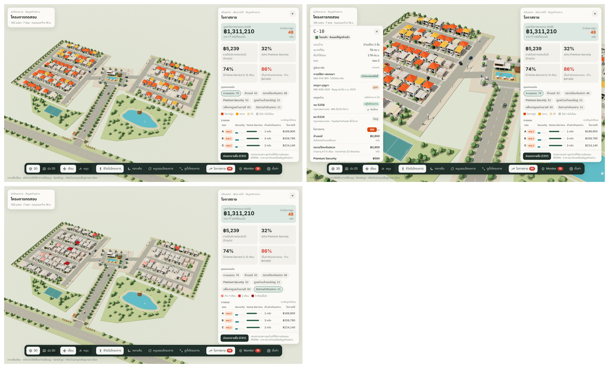

# Village 3D Monitor (prototype)

> Draft — pending review · 2026-10-28

ต้นแบบผังหมู่บ้าน 3 มิติสำหรับนิติบุคคล: ภาพรวมสถานะแปลง, Monitor ความปลอดภัย (SOS, ผู้ติดต่อ, CCTV, AI, กันขโมย, เซ็นเซอร์), โหมดกลางคืน และเลเยอร์ **โอกาสขาย** (Home Service / Premium Security / ค่าส่วนกลาง)

## ใช้งาน
- เปิด `index.html` ในเบราว์เซอร์ได้เลย (ไฟล์เดียว ไม่ต้อง build)
- ต้องต่ออินเทอร์เน็ต: โหลด three.js 0.160.0 จาก jsDelivr และฟอนต์ IBM Plex Sans Thai จาก Google Fonts
- ลิงก์ลัด: `#monitor`, `#settings`, `#sales`, `#CAM-03`

## ข้อมูล
**ข้อมูลทั้งหมดเป็นข้อมูลตัวอย่าง** (ชื่อ เบอร์โทร ทะเบียนรถ ราคา) สร้างจาก random generator แบบกำหนด seed — ไม่ได้เชื่อมกับ SmartWorld หรือระบบจริง

## Stack
Three.js r160 (ES modules ผ่าน import map), HTML/CSS/JS ไฟล์เดียว
